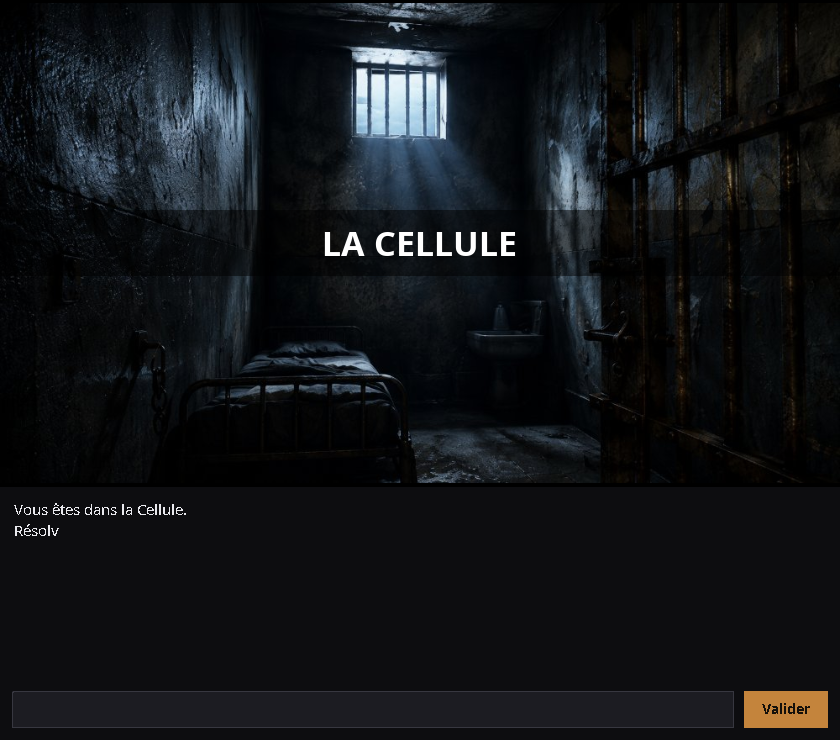

# 🔓 Escape Game — L'Évasion

> Jeu d'évasion en Java, avec **interface graphique Swing**. Incarcéré à tort, vous devez
> vous évader de prison, traverser le vieux-port et libérer votre fille retenue dans un
> hangar, en résolvant une série d'énigmes.

*A Java escape room game with a Swing GUI. (English summary below.)*

Projet académique réalisé en équipe de 4, **repris et retravaillé** pour le portfolio :
correction des bugs bloquants, restructuration en architecture propre, moteur découplé de
l'interface (console **et** graphique), build Maven et tests automatisés.



---

## 🎮 Jouer

Pré-requis : **JDK 17+** et **Maven 3.8+**.

```bash
# Compiler, lancer les tests et produire le jar exécutable
mvn clean package

# Lancer le jeu (interface graphique)
java -jar target/escape-game.jar

# Jouer en mode console (sans fenêtre)
java -jar target/escape-game.jar --console

# (ou directement, sans packager)
mvn exec:java
```

Le jeu tourne **immédiatement après un `git clone`** : aucune base de données ni
configuration externe n'est nécessaire (voir [Authentification](#-authentification)).
En l'absence d'affichage (serveur, CI), le jeu bascule automatiquement en mode console.

Un déroulé complet d'une partie gagnante est aussi disponible dans
[`docs/transcript-partie.txt`](docs/transcript-partie.txt).

---

## 🧩 Le jeu

| Étape | Zone | Épreuve |
|------:|------|---------|
| 1 | La cellule | Une énigme pour ouvrir la porte |
| 2 | Bureau / Cantine / Salle de pause | Récupérer les 3 clés (ordre au choix) |
| 3 | Le vieux-port | Trouver le bon ponton parmi 3 |
| 4 | Le bateau | Cadenas à chiffre + déchiffrer la carte |
| 5 | La forêt | Récupérer pelle, boisson et sac |
| 6 | Le hangar | Énigme finale — libérer votre fille |

Chaque énigme laisse **3 tentatives** ; les échecs mènent à une vraie fin de partie.
À chaque zone, l'interface graphique affiche une **illustration dédiée** sur fond noir
(10 visuels couvrant toutes les zones, les 3 pontons partageant la même vue du vieux-port).

**Animations :** le texte s'écrit **lettre par lettre** (un clic sur le texte ou l'image
accélère l'affichage) et chaque changement d'étape se fait en **fondu enchaîné**, avec le
nom de la zone qui apparaît brièvement en **carton-titre**.

---

## 🏗️ Architecture

Layout Maven standard, package racine `com.escapegame` :

```
src/main/java/com/escapegame/
├── App.java                         point d'entrée (GUI par défaut, --console sinon)
├── io/
│   ├── EntreeSortie.java            ★ frontière moteur ↔ interface
│   └── Console.java                 implémentation console (un seul Scanner partagé)
├── ui/
│   ├── FenetreJeu.java              ★ interface Swing sombre (implémente EntreeSortie)
│   └── ImagesZones.java             illustration par zone (+ visuel de secours généré)
├── game/Partie.java                 moteur de jeu (boucle, progression, fin)
├── player/Joueur.java, Inventaire.java
├── world/Zone.java                  les zones traversées
├── puzzle/Enigme.java, Devinette.java, Objet.java
└── auth/ServiceAuthentification.java, DepotJoueurs.java
src/main/resources/images/           10 illustrations de zones (cellule, bureau, …, hangar)
```

### 🔌 Moteur découplé de l'interface

Le moteur (`Partie`) ne dépend que de l'interface **`EntreeSortie`** (`afficher`,
`lireLigne`, `lireEntier`, `afficherZone`…). Deux implémentations la fournissent :
`Console` (terminal) et `FenetreJeu` (Swing). **La logique de jeu est identique** dans les
deux modes. Côté graphique, le moteur tourne sur un thread dédié et les saisies transitent
par une file bloquante alimentée par l'EDT — l'interface ne se fige jamais.

### 🔑 Authentification

Les comptes sont stockés dans un simple fichier CSV (`data/joueurs.csv`, créé au besoin
et ignoré par git). Les mots de passe ne sont **jamais stockés en clair** : on conserve
un sel aléatoire et l'empreinte **SHA-256** de `sel + mot de passe`. Aucune dépendance
externe, aucun serveur de base de données.

---

## ♻️ Ce qui a été retravaillé

La version rendue était injouable. Les correctifs principaux :

| Problème d'origine | Correctif |
|--------------------|-----------|
| Chaque classe créait son `Scanner(System.in)` puis le **fermait** → `System.in` fermé pour tout le programme, crash à la 2ᵉ saisie | E/S centralisées derrière `EntreeSortie` ; le `Scanner` console n'est jamais fermé en cours de jeu |
| `Commande.se_deplacer()` : `while(true)` sans sortie | Boucle de jeu réécrite avec des conditions d'arrêt claires |
| `trouverPonton()` : compteur d'essais jamais incrémenté → boucle infinie | Nombre d'essais limité et borné |
| Sélection d'énigme `9 + rand.nextInt(14)` → index 22 sur un tableau de 15 → `ArrayIndexOutOfBoundsException` | Sous-plages par niveau disjointes et bornées |
| Authentification MySQL : dépôt jamais instancié (NPE), colonnes SQL incohérentes, injection SQL | Persistance fichier zéro-config + mots de passe hashés |
| Interface visuelle rudimentaire (popups d'images séparés, la plupart des images manquantes) | Fenêtre Swing unique : image de zone + énigmes + saisie, moteur découplé de l'UI |

Bénéfices transverses : code **testable** (interface d'E/S injectable), séparation des
responsabilités, dépôt nettoyé et allégé.

---

## ✅ Tests

```bash
mvn test
```

16 tests JUnit 5 couvrant : les bornes de sélection d'énigmes, la vérification tolérante
des réponses, l'inscription/connexion et le hachage des mots de passe, la robustesse des
E/S, le rendu des images de zones, et un test de bout en bout garantissant qu'une partie
se termine **sans boucle infinie** (anti-régression des deux bugs majeurs).

---

## 🛠️ Stack technique

Java 17 · Maven · Swing (JDK) · JUnit 5 · `java.security.MessageDigest` (SHA-256).

---

## English summary

A Java escape room game with a **Swing GUI**, originally a 4-person academic project,
**reworked for portfolio use**. You escape from prison, cross the old port and free your
daughter by solving riddles. The submitted version was unplayable; this rewrite fixes the
blocking bugs (a shared `Scanner` closed mid-game, infinite loops, an out-of-bounds puzzle
picker, broken MySQL auth), restructures the code into clean packages, and **decouples the
game engine from the UI** behind an `EntreeSortie` interface so the exact same engine runs
in a Swing window or in the terminal (`--console`). Player accounts use **zero-config file
storage with SHA-256 hashed passwords**, and the project ships a Maven build with JUnit 5
tests.

Run it with `mvn clean package && java -jar target/escape-game.jar`.
