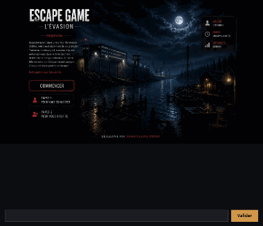

# Fiche projet — Escape Game : L'Évasion

> Bloc prêt à coller dans ton portfolio (Markdown). Adapte les liens (Release, dépôt).
> Pense à héberger `docs/demo.gif` avec ta page, ou à pointer vers le fichier du dépôt.

---

## 🇫🇷 Version française

### Escape Game — L'Évasion · Jeu d'aventure (Java / Swing)



Jeu d'évasion narratif à **interface graphique** : incarcéré à tort, le joueur s'évade
d'une prison côtière, traverse le vieux-port et libère sa fille, en résolvant une série
d'énigmes. Projet académique d'équipe que j'ai **entièrement retravaillé** : correction des
bugs bloquants, **architecture découplée** (même moteur jouable en fenêtre Swing ou en
console), **10 décors illustrés**, animations (texte lettre par lettre, fondus enchaînés,
cartons-titres) et build automatisé avec tests.

**Points techniques**
- Architecture **moteur ↔ interface** découplée via une seule abstraction d'E/S
- Interface **Swing** : thème sombre, typographie soignée, transitions animées
- Persistance **zéro-config** des comptes (fichier + mots de passe hachés SHA-256)
- Build **Maven**, **18 tests JUnit 5**, jar exécutable autonome

**Stack** : Java 17 · Swing · Maven · JUnit 5

🔗 **Code & README** : https://github.com/Rama-30/Escape_game
▶️ **Jouer** : télécharger le `.jar` depuis les [Releases](https://github.com/Rama-30/Escape_game/releases) puis `java -jar escape-game.jar` *(Java 17+)*

---

## 🇬🇧 English version

### Escape Game — The Escape · Adventure game (Java / Swing)


A narrative escape-room game with a **graphical interface**: wrongly imprisoned, the player
breaks out of a coastal prison, crosses the old port and frees their daughter by solving a
series of riddles. A team academic project that I **fully reworked**: fixed the
show-stopping bugs, **decoupled the engine from the UI** (the same engine runs in a Swing
window or in the terminal), added **10 illustrated scenes**, animations (typewriter text,
cross-fades, title cards) and an automated build with tests.

**Highlights**
- **Engine ↔ UI** decoupled behind a single I/O abstraction
- **Swing** UI: dark theme, refined typography, animated transitions
- **Zero-config** account storage (file + SHA-256 hashed passwords)
- **Maven** build, **18 JUnit 5 tests**, self-contained runnable jar

**Stack**: Java 17 · Swing · Maven · JUnit 5

🔗 **Code & README**: https://github.com/Rama-30/Escape_game
▶️ **Play**: download the `.jar` from [Releases](https://github.com/Rama-30/Escape_game/releases), then `java -jar escape-game.jar` *(Java 17+)*

---

### Version compacte (une ligne, pour une grille de projets)

```markdown
**Escape Game — L'Évasion** · Java/Swing · Jeu d'évasion à interface graphique (10 décors,
énigmes, animations), projet d'équipe retravaillé (archi découplée, tests, build Maven).
[Code](https://github.com/Rama-30/Escape_game) · [Jouer](https://github.com/Rama-30/Escape_game/releases)
```
